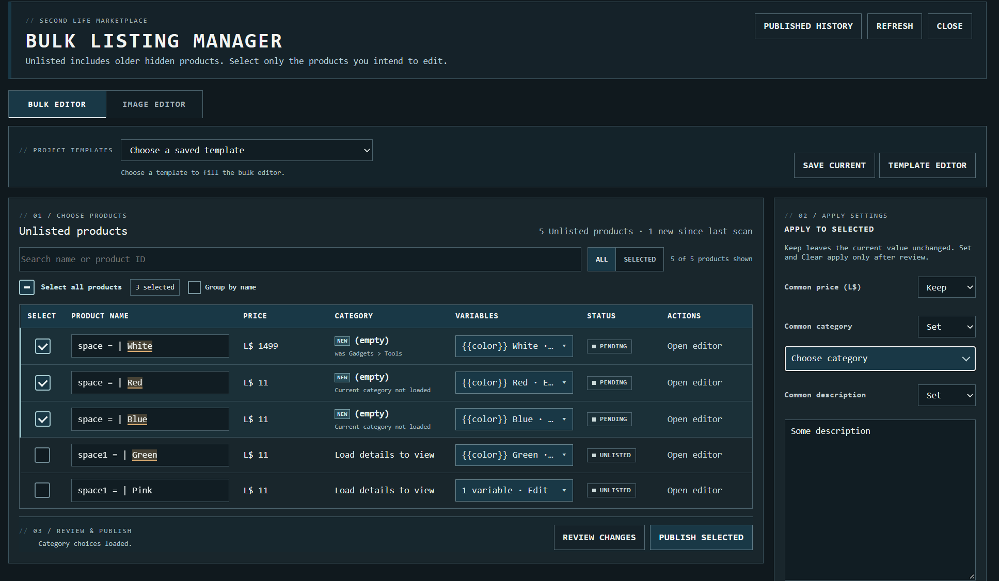

# Listora Studio user guide

Listora Studio is a Chrome extension for sellers who edit Second Life Marketplace listings. It provides **Studio** on a product edit page and **Bulk Editor** on **Manage Listings**. Use this guide to install it, activate a license, prepare listings, and check the result of every save or publication.

> The extension is named **Listora Studio** in Chrome. “Marketplace Studio” was the working name in the documentation brief. This guide uses the name shown by the product.

## Get Listora Studio

**After purchase:** You receive a HUD in Second Life. Click it to open the license website, where you can find your license and download the extension. Then follow [installation](installation.md) and [license activation](license-activation.md). The direct official Second Life Marketplace product URL is pending confirmation; license duration and renewal terms depend on the product listing and seller.

## Start here

1. [Getting started](getting-started.md) — purchase, HUD, download and first-listing workflow.
2. [Installation](installation.md) — install the downloaded build or build from source.
3. [License activation](license-activation.md) — enter your key and confirm status.

## Single listing

| Chapter | What you will learn |
| --- | --- |
| [Product Editor](product-editor.md) | General, Content, Media, Advanced, saving and Original view |
| [Quick Fill](quick-fill.md) | Copy fields from another Marketplace listing |
| [Languages and translation](languages-translation.md) | Edit localized fields and use browser translation if available |
| [Image tools](image-tools.md) | Prepare a single listing image and use Marketplace upload controls |

## Multiple listings

| Chapter | What you will learn |
| --- | --- |
| [Bulk Editor](bulk-editor.md) | Scan, search, select and edit Unlisted products |
| [Bulk Image Editor](bulk-image-editor.md) | Match, queue and upload images |
| [Dynamic variables](dynamic-variables.md) | Use `{{variable}}` in listing text |
| [Project templates](project-templates.md) | Save and reuse bulk settings |
| [Description tools](description-tools.md) | Add text and run Find & Replace |
| [Review and publishing](review-publishing.md) | Compare changes, save or publish, and handle failures |
| [Publishing history](publishing-history.md) | Revisit locally stored results |

## Help

[Tips and workflows](tips-and-workflows.md) · [Troubleshooting](troubleshooting.md) · [FAQ](faq.md)

Need a license? The direct official product link is pending confirmation. See [license activation](license-activation.md) if you already have a key.
