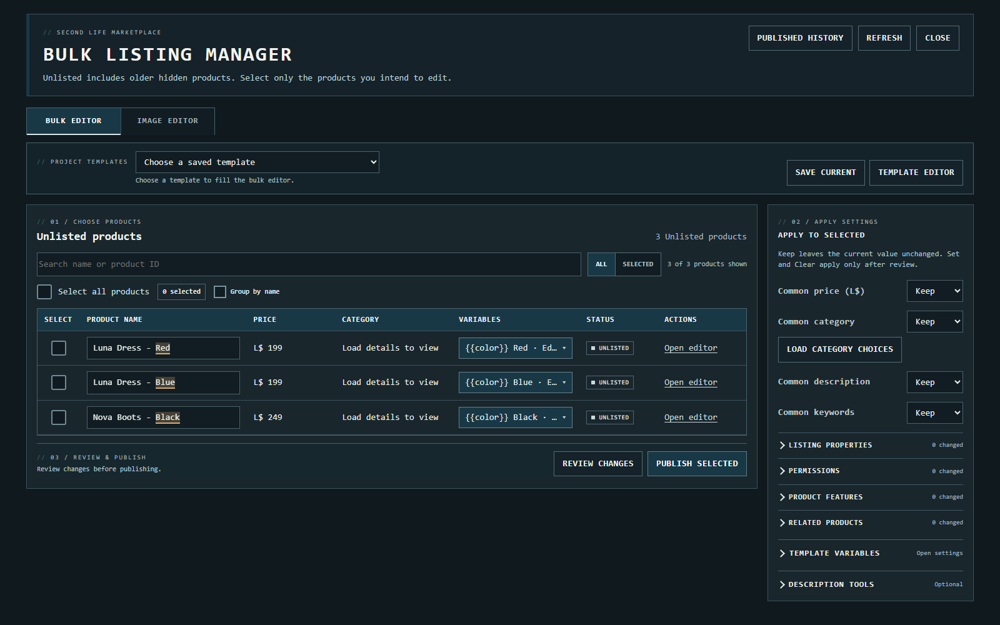

# Bulk Editor: choose and change products

[← Image tools](image-tools.md) · [Guide home](README.md) · [Next: Bulk Image Editor →](bulk-image-editor.md)

On **Manage Listings**, click **Bulk Editor**. It scans Marketplace's **Unlisted** filter across its available pages. Unlisted can include older hidden products. **New since last scan** only marks products first seen after an earlier scan by this extension.

## Select the intended listings

1. Use **Search name or product ID** to narrow the list. **All / Selected** changes which rows are visible.
2. Check individual products or **Select all products**. Review the selection count before applying shared fields.
3. Optionally enable **Group by name** to keep similar variants together. Edit an individual **Product Name** directly in its row.
4. Use **Open editor** on a row if it needs detailed changes in the single-product Studio.

## Set shared values

Under **Apply to selected**, choose a mode for each common field:

| Mode | Result |
| --- | --- |
| **Keep** | Leave that product's current value unchanged |
| **Set** | Use the value entered in Bulk Editor |
| **Clear** | Empty the field when that field supports clearing |

Common controls include price, category, description and keywords. For a category, click **Load category choices** to read the Marketplace category tree, then choose a category. Expand **Listing Properties** for maturity, mesh, usage and wearable; **Permissions** for Copy, Modify, Transfer, See Description and User Licensed; **Product Features** for the five feature lines; and **Related Products** for the Demo Item. Boolean permissions use **Keep / Enabled / Disabled**. Some other property modes cannot be cleared. Demo Items must come from Marketplace search results and cannot point to the product itself.

Changes remain a local draft until you confirm them in [Review and publishing](review-publishing.md). A refreshed scan preserves checked product IDs; check the list again if products or Marketplace pages have changed.

**Example:** Select “Luna Dress — Black” and “Luna Dress — Red,” set one shared price of L$299, keep their individual names, and review both rows.

Need a license? The direct official product link is pending confirmation. See [activation](license-activation.md).
