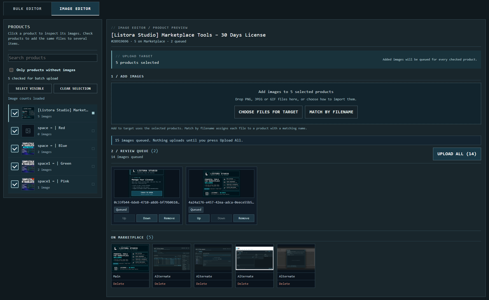

# Bulk Image Editor

[← Bulk Editor](bulk-editor.md) · [Guide home](README.md) · [Next: Dynamic variables →](dynamic-variables.md)

Open **Bulk Editor** on **Manage Listings**, then switch from **Bulk Editor** to **Image Editor**. This view shows products, their current Marketplace images and local upload queues.

*Select the upload target, inspect the queue and check images already on Marketplace.*

1. Search for a product and click its row, or check several products to receive the same added files.
2. Use **Choose files for target** to add files to the checked products, or **Match by filename** to assign each file to a product with a matching name. For an **Unmatched file**, choose the intended product and click **Assign**, or **Skip** it.
3. Inspect the queue under each product. Use **Up**, **Down** and **Remove** to correct order and membership. Check existing Marketplace images in the current-image area.
4. Review the prepared list and click **Upload all** to start. Adding files to a queue does not upload them.
5. Follow progress and failures, then open the affected products on Marketplace to verify the result.

The upload queue works through images sequentially and checks the product again after each upload. **Stop after current item** stops after the in-progress image; already uploaded images remain on Marketplace. If a file fails, correct it and use **Retry Failed** after checking the status. An existing image's **Delete** action requires confirmation and then rechecks the listing.

**Example:** Use filenames such as `Luna Dress — Black.png` and `Luna Dress — Red.png`, inspect the proposed match for each, and upload only after each product's queue is correct. A batch selection sends added files to every checked product, so clear unintended checkboxes first.

See [Image tools](image-tools.md) for file requirements and the single-listing editor.

Need a license? The direct official product link is pending confirmation. See [activation](license-activation.md).
