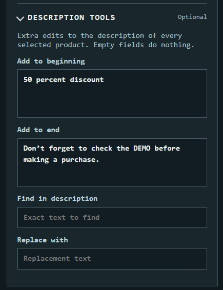

# Description tools

[← Project templates](project-templates.md) · [Guide home](README.md) · [Next: Review and publishing →](review-publishing.md)

Open **Bulk Editor → Description tools** when several selected listings need a shared text change. Empty fields do nothing.

*These fields prepare shared text changes. The resulting text is checked in Review changes.*

| Control | Action |
| --- | --- |
| **Add to beginning** | Put text before each current description |
| **Add to end** | Put text after each current description |
| **Find** and **Replace** | Replace matching text throughout each description |

1. Select the intended products, then enter one or more description edits.
2. Check the inline preview and click **Review changes**.
3. Read the old and proposed description of every product. Confirm only after the text is correct.

**Example:** Add a concise sizing note to the end of two Luna Dress descriptions. If one already contains the note, adjust that product separately or you may duplicate it. Find & Replace acts on literal matching text; review capitalization and formatting in every result. If a draft also uses `{{variable}}`, inspect the final expanded text in the review.

**Save Changes** writes the revised descriptions without listing; **Publish Selected** also attempts listing. Both are covered in [Review and publishing](review-publishing.md).

Need a license? The direct official product link is pending confirmation. See [activation](license-activation.md).
