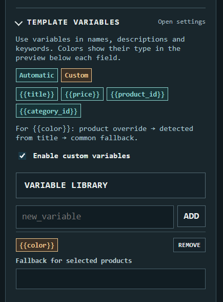
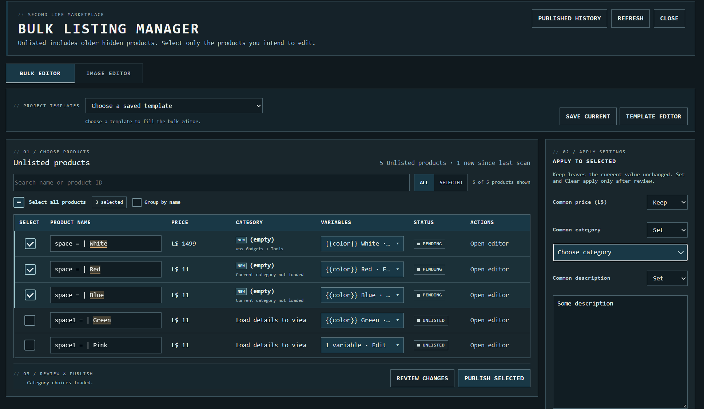

# Dynamic variables

[← Bulk Image Editor](bulk-image-editor.md) · [Guide home](README.md) · [Next: Project templates →](project-templates.md)

In **Bulk Editor → Template variables**, write `{{variable}}` in a name, description, keyword or product feature draft. The preview shows each product's resulting text before you save or publish.

*Template variables settings include automatic values and the custom `{{color}}` variable.*

*The Variables column shows each product's current `{{color}}` value.*

| Variable | Value |
| --- | --- |
| `{{title}}` | Current product title used by the draft |
| `{{price}}` | Product price |
| `{{product_id}}` | Marketplace product ID |
| `{{category_id}}` | Category ID |
| `{{color}}` | Custom value: product override, detected title value, then common fallback |

You can add other custom names such as `{{size}}` using letters, numbers and underscores, with a letter first. The **Variable library** stores reusable sets of suggested values. Create a set, **Save**, then **Add to Bulk**. Select or override a value for each product, or set a shared fallback. **Enable custom variables** controls whether custom substitution applies to the current draft.

1. Add `{{color}}` to a shared description, for example `Luna Dress in {{color}}.`
2. Select the Black and Red variants and check each row's detected or assigned color.
3. Open **Review changes** and read the actual expanded descriptions. Fix blanks or wrong values before confirming.

Automatic detection uses the product title and library suggestions; ambiguous names may need manual values. The library and draft are local to the seller in this Chrome profile. Deleting a library set does not automatically remove already entered Bulk values.

Need a license? The direct official product link is pending confirmation. See [activation](license-activation.md).
