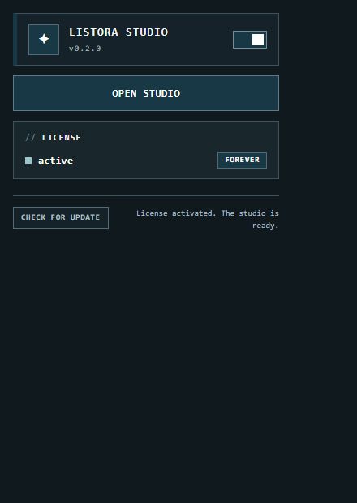

# Listora Studio — руководство пользователя

Listora Studio — расширение Chrome для редактирования товаров в [Second Life Marketplace](https://marketplace.secondlife.com/). Оно добавляет **Studio** на страницу редактирования товара и **Bulk Editor** на страницу **Manage Listings**.

> Скриншоты ниже сделаны из интерфейса версии 0.2.0 с демонстрационными товарами. В вашем магазине названия, категории и доступные действия могут отличаться.

## Начните здесь

1. [Установите расширение](installation.md).
2. [Активируйте лицензию](activation.md).
3. Войдите в Second Life Marketplace в Chrome под своим аккаунтом продавца.
4. Откройте **Edit Item Listing** для одного товара и познакомьтесь с [редактором Studio](studio.md).
5. Когда будете готовы работать с несколькими товарами, прочитайте [руководство по Bulk Editor](bulk-editor.md).

## Что умеет расширение

| Задача | Где искать |
| --- | --- |
| Изменить один товар | **Studio** на странице **Edit Item Listing** |
| Скопировать данные из другого товара | **Quick fill** в Studio |
| Сохранить несколько товаров без публикации | **Bulk Editor → Review changes → Save Changes** |
| Сохранить и опубликовать выбранные товары | **Bulk Editor → Review changes → Publish Selected** |
| Подготовить и загрузить изображения для нескольких товаров | Вкладка **Image Editor** в Bulk Editor |
| Повторно использовать набор изменений | **Save current**, **Template editor**, библиотека переменных |
| Посмотреть сохранённое состояние опубликованных товаров | **Published history** |

Изменения в Studio и Bulk Editor сначала показываются локально. Перед отправкой на Marketplace проверьте поля и выбранные товары. Для первой массовой публикации используйте один неважный товар: запрос публикации проверен локальными тестами, но живой ответ Marketplace в проекте пока не проверялся.

## Дополнительно

- [Частые вопросы и устранение неполадок](troubleshooting.md)
- [Установка и обновление](installation.md#обновление)
- [Какие данные используются](troubleshooting.md#данные-и-доступ)

Кнопки в расширении подписаны по-английски. В руководстве они приведены так же, как в интерфейсе.
