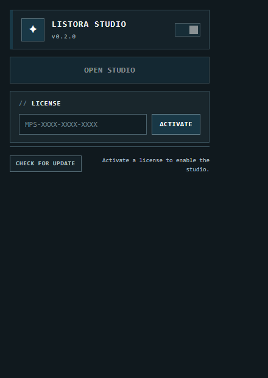
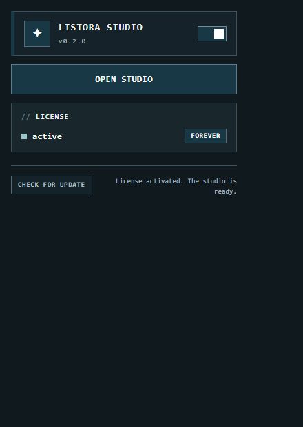

# Активация лицензии

[← К началу](README.md) · [Установка](installation.md) · [Далее: Studio →](studio.md)

После установки нажмите значок **Listora Studio** на панели Chrome. До активации кнопка **Open studio** и переключатель расширения недоступны.

1. Получите ключ лицензии у распространителя расширения. В этом репозитории нет страницы покупки или выдачи ключей.
2. Вставьте ключ в поле **License** и нажмите **activate**.
3. Дождитесь сообщения **License activated. The studio is ready.** В окне появится статус **active** и срок действия лицензии.
4. Войдите в [Second Life Marketplace](https://marketplace.secondlife.com/) обычным способом и откройте страницу товара или **Manage Listings**.

Для активации требуется соединение с сервером лицензирования. Расширение передаёт ключ лицензии и идентификатор установки на `marketplace-studio.didyacool.workers.dev`; при последующих проверках — токен лицензии и идентификатор установки. Пароль Second Life в расширение вводить не нужно.

Если ключ не принимается, проверьте его написание и связь с интернетом. Сообщение **The license server is unreachable** означает, что сервер проверки сейчас недоступен. Дополнительные шаги есть в [разделе неполадок](troubleshooting.md#лицензия-не-активируется).

> Показанный в окне срок действия берётся из ответа сервера. В текущей версии локальная проверка истечения срока при недоступном сервере не реализована; при вопросах о сроке ориентируйтесь на условия вашей лицензии и ответ распространителя.
