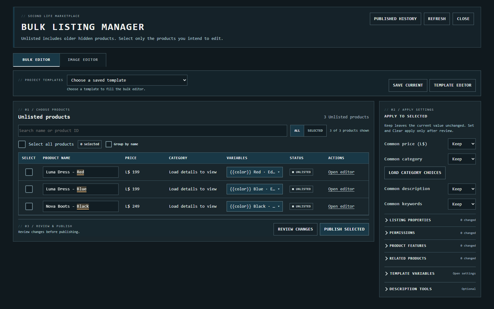

# Bulk Editor: несколько товаров

[← К началу](README.md) · [Studio](studio.md) · [Неполадки →](troubleshooting.md)

На странице продавца **Manage Listings** нажмите **Bulk Editor**. Он загружает товары из фильтра **Unlisted** и проходит доступные страницы списка. В эту группу могут входить старые скрытые товары, поэтому выбирайте товары внимательно. Метка **New since last scan** означает только то, что товар впервые появился после предыдущего сканирования расширением.

## Сохранение или публикация

1. Отметьте нужные строки. Используйте поиск по имени или ID; **Selected** показывает только отмеченные товары. Имя отдельного товара можно поправить прямо в таблице.
2. В блоке **Apply to selected** выберите режим для каждого общего поля: **Keep** сохраняет текущее значение, **Set** задаёт новое, **Clear** очищает поле, если это действие доступно. Для категории сначала нажмите **Load category choices** и выберите категорию из дерева Marketplace.
3. Если нужно, раскройте **Listing properties**, **Permissions**, **Product features**, **Related products**, **Template variables** или **Description tools**.
4. Нажмите **Review changes** или нижнюю кнопку **Publish Selected**. Откроется просмотр исходных и новых значений каждого товара, а также предупреждений.
5. В окне просмотра нажмите **Save Changes**, чтобы сохранить правки без публикации, либо **Publish Selected**, чтобы сохранить и выставить товары. До этого шага изменения остаются локальными.

Очередь работает по одному товару. **Stop after current item** останавливает её после текущего товара; **Retry Failed** запускает повторный просмотр неудачных товаров. После выполнения прочитайте статусы строк. Успешный HTTP-ответ сам по себе не считается подтверждением публикации: расширение дополнительно ищет товар в списке **Listed**.

**Перед первой большой партией опубликуйте один неважный товар и проверьте его на сайте.** Запрос публикации пока проверен локальными тестами, но не подтверждён живым ответом Marketplace.

## Шаблоны и переменные

- **Save current** сохраняет текущие настройки как проектный шаблон. **Template editor** позволяет редактировать сохранённые шаблоны.
- В **Template variables** можно использовать `{{title}}`, `{{price}}`, `{{product_id}}`, `{{category_id}}` и собственные переменные, например `{{color}}`.
- Для собственных переменных можно хранить наборы допустимых значений. Перед отправкой обязательно проверьте подстановку для каждого товара в окне просмотра.
- **Description tools** добавляет текст до или после описания и выполняет Find & Replace.

Шаблоны и библиотека переменных сохраняются в этом браузере отдельно для каждого продавца. Удаление данных расширения в Chrome может удалить эти записи.

## Image Editor

Откройте вкладку **Image Editor** внутри Bulk Editor. Выберите один товар или отметьте несколько, добавьте файлы, проверьте соответствие между изображениями и товарами и предварительный просмотр. Неподходящее изображение можно подготовить в локальном редакторе перед загрузкой. Нажатие **Upload** начинает отправку; добавление файла в очередь само по себе ничего не загружает.

После загрузки расширение повторно читает страницу товара и проверяет, что число его изображений увеличилось. Удаление текущего изображения требует отдельного подтверждения и проверяется повторной загрузкой списка. При сомнении откройте товар на Marketplace и проверьте результат вручную.

## Published history

Кнопка **Published history** показывает сохранённое расширением состояние товаров, опубликованных через Bulk Editor, и применённые переменные. Для одного товара хранится последняя запись: повторная публикация заменяет предыдущую. Эта история локальная и не является журналом всех изменений Marketplace.
