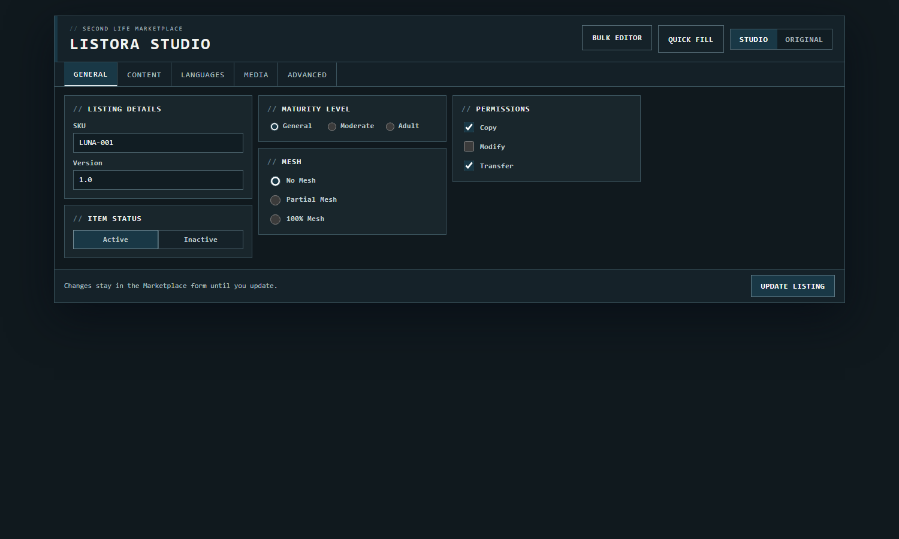

# Редактирование одного товара в Studio

[← К началу](README.md) · [Активация](activation.md) · [Далее: Bulk Editor →](bulk-editor.md)

Войдите в Marketplace и откройте страницу **Edit Item Listing** существующего товара. После загрузки страницы появится интерфейс Listora Studio.

## Основной порядок работы

1. Откройте нужную вкладку: **General**, **Content**, **Languages**, **Media** или **Advanced**.
2. Измените поля. Studio редактирует существующую форму Marketplace; данные ещё не отправлены.
3. Нажмите **Update listing**. Это вызывает обычное сохранение Marketplace. При ошибке обязательных полей исправьте их; если сообщение сайта не видно в Studio, переключитесь на **Original**.
4. После сохранения проверьте товар на Marketplace. Сайт может перенаправить вас на другую страницу.

Переключатель **Studio / Original** меняет вид редактора. Он не удаляет заполненную форму: можно перейти в исходный интерфейс Marketplace и обратно без потери текущих правок.

## Вкладки и действия

- **General** — SKU, версия, статус, зрелость, параметры mesh, разрешения и другие общие свойства товара.
- **Content** — название, описание, ключевые слова, особенности, цена и категория товара.
- **Languages** — локализованные поля. Каждая языковая вкладка показывает отдельную локаль. Если браузер поддерживает встроенный перевод, доступна команда перевода; проверяйте результат перед сохранением.
- **Media** — изображения, GIF и PDF через элементы загрузки Marketplace.
- **Advanced** — связанные товары, демо, платные улучшения и распределение выручки через существующие действия сайта.

**Quick fill** открывает штатный выбор существующего товара Marketplace и копирует его данные в форму. После выбора просмотрите название, цену, описание и другие поля перед нажатием **Update listing**.

Действия Marketplace, которые могут повлечь плату, подтверждаются в интерфейсе самого сайта. Studio не отправляет их автоматически.
