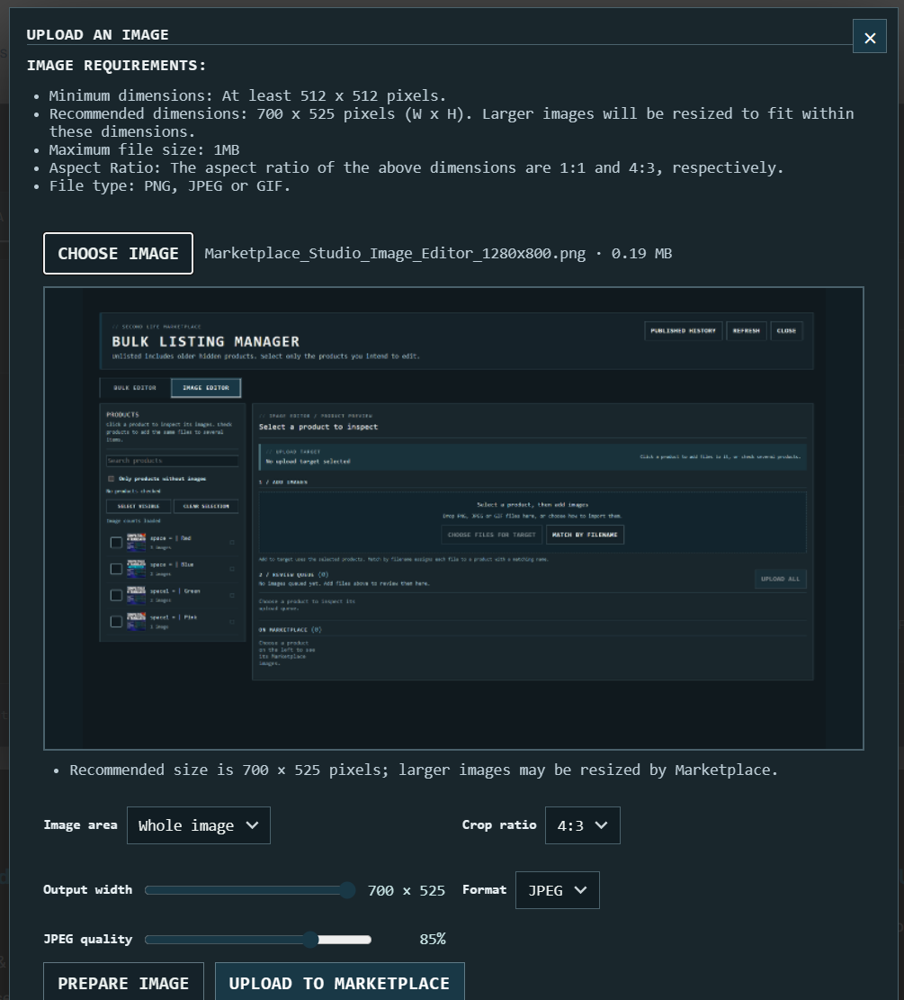

# Image tools for one listing

[← Languages](languages-translation.md) · [Guide home](README.md) · [Next: Bulk Editor →](bulk-editor.md)

Use **Media** on a product edit page to inspect images and reach Marketplace's upload controls. The single-listing image editor prepares a local image before you hand it to Marketplace's uploader.

*The image editor previews a selected file before it is prepared for upload.*

1. Open **Media**, click **Upload an image**, then click **Choose image** in the uploader.
2. Select a PNG, JPEG or GIF. Review the preview and any size warnings.
3. Adjust crop, zoom, output size or quality if needed, then click **Prepare image**.
4. Click **Upload to Marketplace**. Preparing the image alone does not upload it.
5. Watch Marketplace's uploader result and reload the listing to check the image.

The local checks expect PNG, JPEG or GIF, at most **1 MB**, and at least **512 × 512 px**. Images above the recommended **700 × 525 px** may be resized by Marketplace. Cropping or resizing a GIF creates a still image from its first frame; use the unchanged GIF if animation matters. Marketplace's own rules and final upload response decide whether a file is accepted.

Studio also exposes the native GIF and PDF inputs when the page has them. If the handoff to Marketplace fails, switch to **Original** and use its uploader. See [Bulk Image Editor](bulk-image-editor.md) to queue images for several listings.

Need a license? The direct official product link is pending confirmation. See [activation](license-activation.md).
