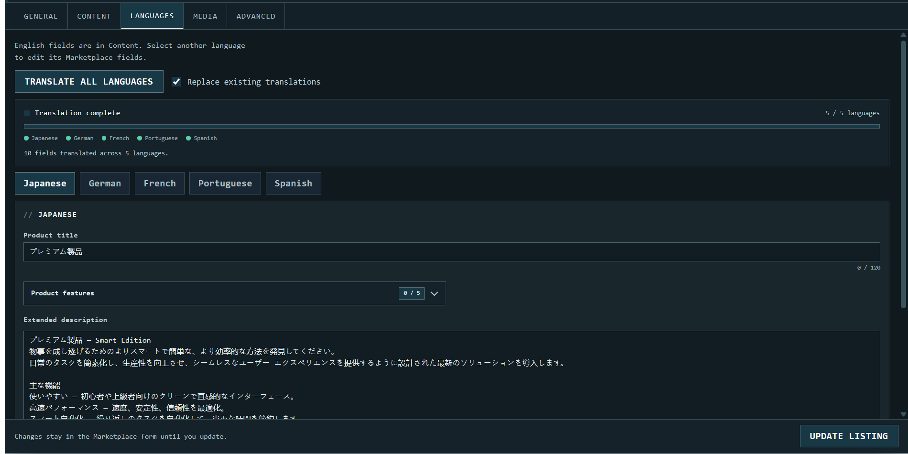

# Languages and translation

[← Quick Fill](quick-fill.md) · [Guide home](README.md) · [Next: Image tools →](image-tools.md)

Open **Languages** in the single-product Studio. Choose a language tab to edit the Marketplace fields for **Japanese**, **German**, **French**, **Portuguese** or **Spanish**. Each language has its own title, five features, description and keywords when those native fields exist.

*The Languages tab shows the translation controls and a Japanese example.*

1. Fill the English content on **Content** first.
2. Open **Languages** and select a locale. You can type localized text directly.
3. If your browser exposes its built-in Translator feature, click **Translate all languages** to process English fields into available language fields. **Replace existing translations** is checked by default; clear it if you want to keep text already entered in localized fields. Watch the per-language progress and any failed or skipped fields.
4. Read every translation, especially product names, sizing, permissions and search keywords. Correct the text before **Update listing**.

Translation is browser dependent. The action reports **Built-in translation is unavailable in this browser** when that capability is absent. Language packs may need to download, and translations exceeding a native field limit are skipped. Do not assume every locale or field was completed because one translated successfully.

**Example:** Translate a short “Luna Dress — Red” description, then manually check the color name and fit terms in each language tab.

Need a license? The direct official product link is pending confirmation. See [activation](license-activation.md).
