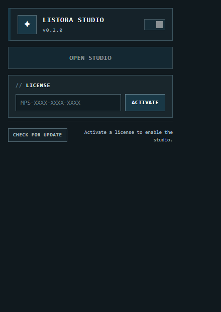
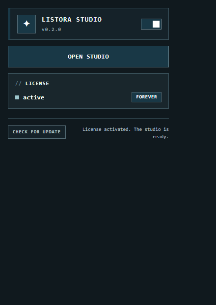

# License activation

[← Installation](installation.md) · [Guide home](README.md) · [Next: Product Editor →](product-editor.md)

Click the **Listora Studio** icon in Chrome after installation. Until activation, **Open studio** and the enabled switch are unavailable.

1. Obtain a license key from the official product seller. The direct product listing URL is pending confirmation.
2. Paste it into **License** and click **activate**.
3. Wait for **License activated. The studio is ready.** The popup then shows **active** and the expiration date returned by the license service.
4. Sign in to Marketplace, open a seller product page and reload it if necessary.

Activation needs a connection to the licensing service. The extension sends the key and an installation ID for activation; later checks use a license token and installation ID. You never enter your Second Life password into the extension. The shown expiration comes from the service; check your purchase terms or ask the seller about renewal.

If you see **This license key was not accepted**, check the key and contact the seller if it remains rejected. **The license server is unreachable** indicates a connection or service problem; try again later. See [license troubleshooting](troubleshooting.md#license-activation-fails).

Need a license? The direct official Second Life Marketplace product link is pending confirmation; no purchase or renewal URL has been verified yet.
