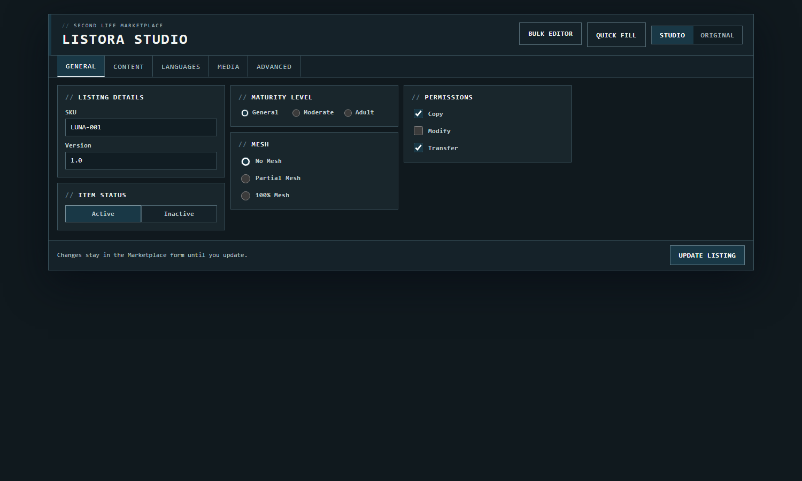

# Product Editor: one listing

[← License activation](license-activation.md) · [Guide home](README.md) · [Next: Quick Fill →](quick-fill.md)

Open **Edit Item Listing** for a seller product. Studio appears over the existing Marketplace edit form. The **Studio / Original** switch changes views without discarding the form or its current values.

## Edit and save

1. Open the relevant tab and change the fields you need.
2. Review the fields in other tabs, especially title, price, permissions and maturity.
3. Click **Update listing**. Studio highlights missing required fields it can detect.
4. If Marketplace reports another error, switch to **Original** and read the site message.
5. After a successful update, open or reload the listing to verify the result. Marketplace may navigate away after saving.

## Tabs

| Tab | Available controls |
| --- | --- |
| **General** | SKU, version, Active/Inactive, maturity, mesh and fitted mesh, Copy/Modify/Transfer and other permissions, automatic redelivery, usage requirements, wearable, avatar compatibility and brand fields |
| **Content** | English item title, five product features, extended description, keywords, price in L$, land impact and Marketplace category control |
| **Languages** | Localized title, features, description and keywords for Japanese, German, French, Portuguese and Spanish; optional browser translation |
| **Media** | Existing images and Marketplace image controls, plus GIF and PDF upload actions when the original page offers them |
| **Advanced** | Available quantity (unlimited or limited), related items, Demo Item, listing enhancements and revenue distributions using Marketplace's own controls |

Some controls appear only if Marketplace includes them for that listing. Studio mirrors the site's existing fields; it does not create additional Marketplace fields. Product features stay collapsed until you open them.

**Quick fill** opens Marketplace's existing listing chooser; see [the detailed workflow](quick-fill.md). Related products and Demo Item use the site's own selectors. Paid listing enhancements require a separate action and Marketplace confirmation; inspect the charge before accepting it.

**Example:** For “Luna Dress — Black,” edit **Content → Item title**, price and keywords, then confirm **General → Maturity Level** and **Permissions** before **Update listing**.

Need a license? The direct official product link is pending confirmation. See [activation](license-activation.md).
