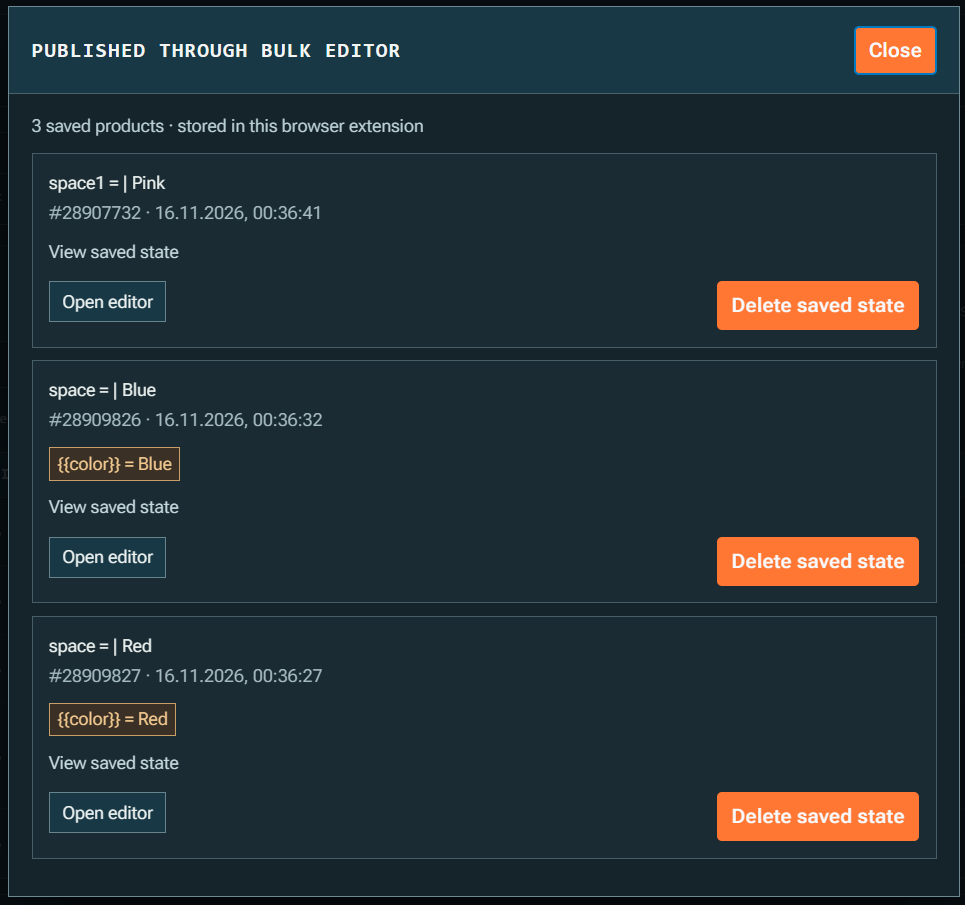

# Publishing history

[← Review and publishing](review-publishing.md) · [Guide home](README.md) · [Next: Tips and workflows →](tips-and-workflows.md)

Click **Published history** in Bulk Editor to see locally saved records of products published through the extension. Records include the saved state and variables used for that product. Use **Open editor** to inspect a product on Marketplace.

*The local history lists saved products and the variable values used for them.*

The history is scoped to the current merchant and Chrome profile. It stores the latest record for a product, so publishing it again replaces the prior record. It is not a complete Marketplace audit log and does not include changes made elsewhere.

Some saved variable values can be revisited on a product edit page. Review the rendered text, apply it to the current form, then click **Update listing** in Studio to save it on Marketplace. Merely applying a value to the form does not submit it.

Deleting a history record uses **Confirm delete** and removes the local record, not the Marketplace product. Clearing extension storage or removing the extension can erase the records.

**Example:** After publishing “Luna Dress — Black,” open its history record to check the final `{{color}}` value, then open the Marketplace editor to verify current public content.

Need a license? The direct official product link is pending confirmation. See [activation](license-activation.md).
